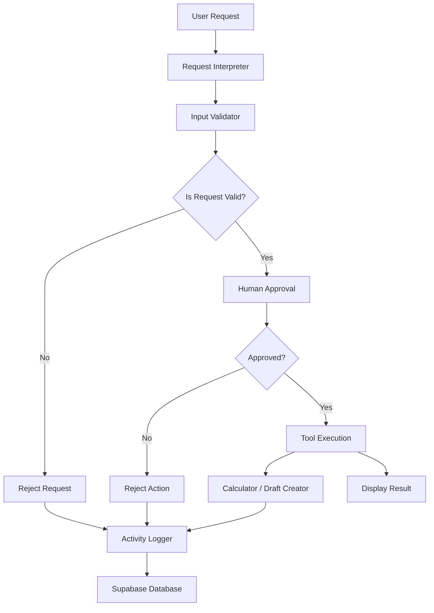

# SafeAI – System Architecture

## 1. Project Overview

SafeAI is a reliable AI agent prototype that demonstrates tool validation, human approval, controlled tool execution, and activity logging.

The application uses Python, Streamlit, and Supabase.

## 2. System Architecture

The system follows a step-by-step workflow:

1. User enters a request.
2. Request Interpreter identifies the requested operation.
3. Validator checks the tool and input arguments.
4. Invalid requests are rejected.
5. Valid requests are displayed for human approval.
6. The user approves or rejects the proposed action.
7. Approved requests are executed using the selected tool.
8. Activity details are stored in Supabase.

## 3. Architecture Diagram

## 4. Main Components

### Request Interpreter
Identifies supported user requests and extracts the required arguments using predefined Python rules.

### Validator
Checks input values, required arguments, data types, and supported tool operations.

### Human Approval
Allows the user to approve or reject a proposed action before execution.

### Tool Execution
Executes the selected tool after approval.

Available tools:
- Calculator
- Draft Creator

### Activity Logger
Records request details, validation status, approval status, and execution results.

### Supabase Database
Stores activity records for monitoring and review.

### Streamlit Dashboard
Provides an interactive interface to enter requests, review proposed actions, approve or reject them, and view activity logs.

## 5. Technologies Used

- Python – Application logic
- Streamlit – User interface
- Supabase – Database and activity logging
- VS Code – Development environment
- Git and GitHub – Version control and project hosting

## 6. Conclusion

SafeAI demonstrates a controlled tool-execution workflow. It uses input validation, human approval, and activity logging to make automated operations more transparent and reliable.

The current prototype uses rule-based request interpretation. Integration with a Large Language Model can be considered as a future improvement.
